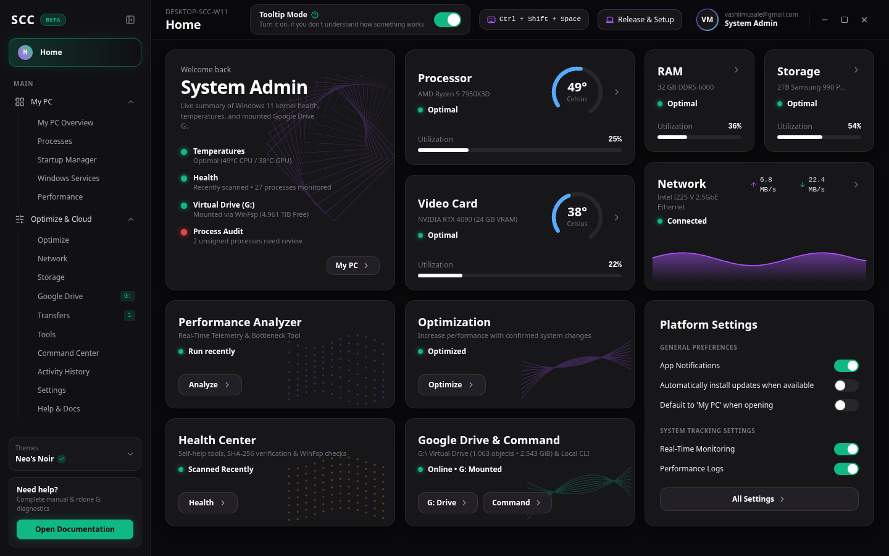
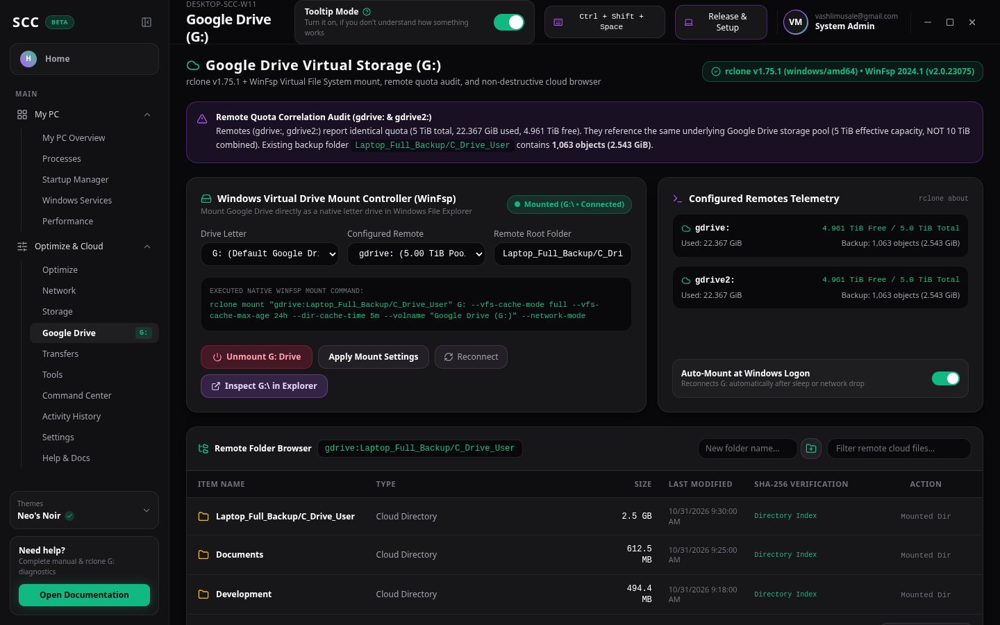
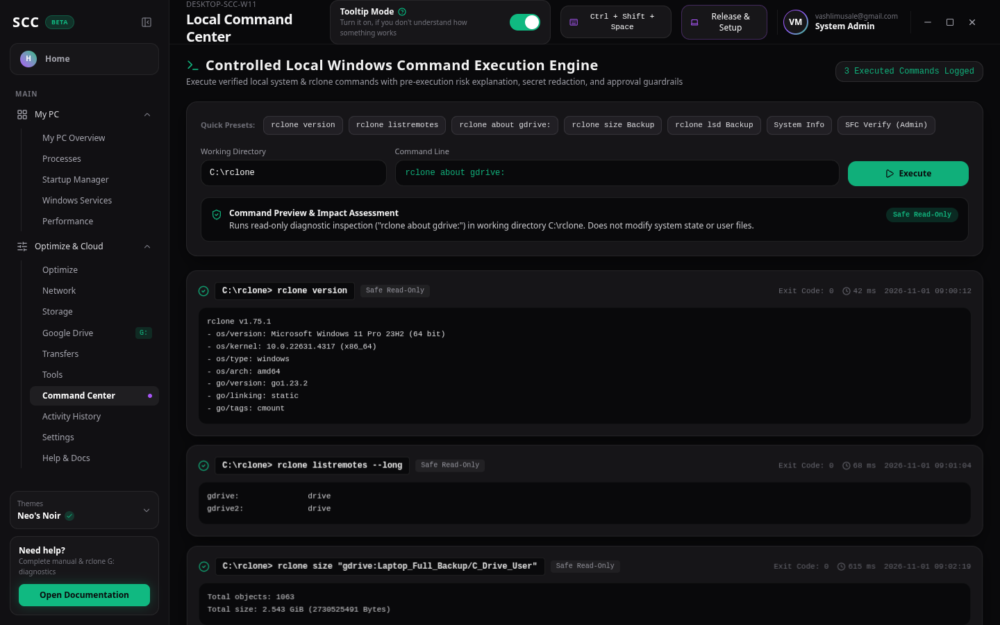
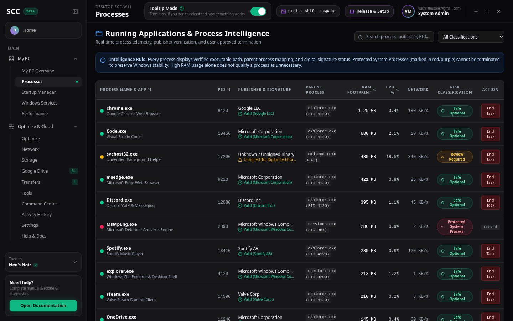
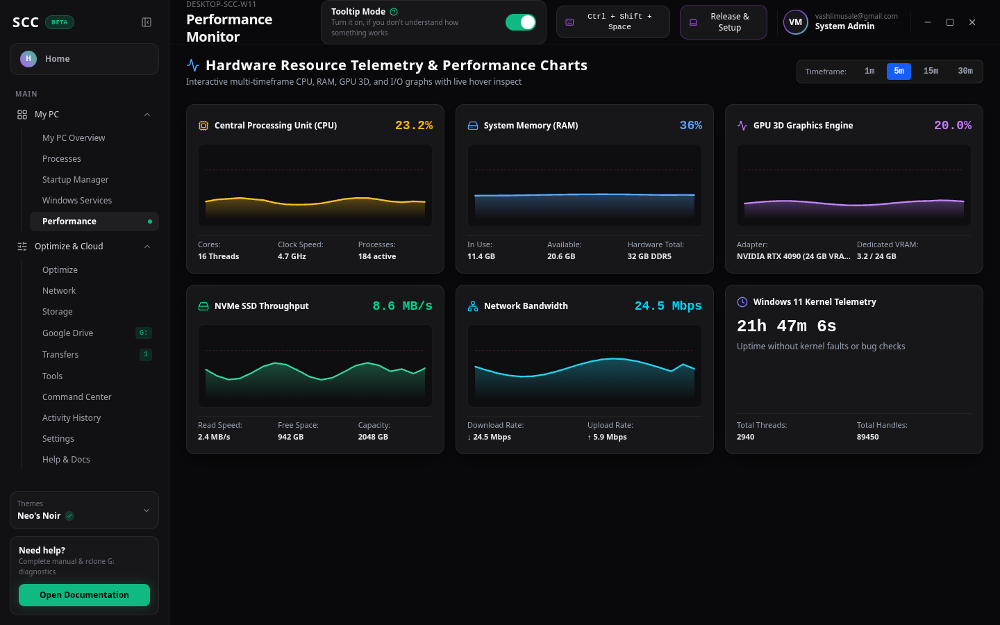
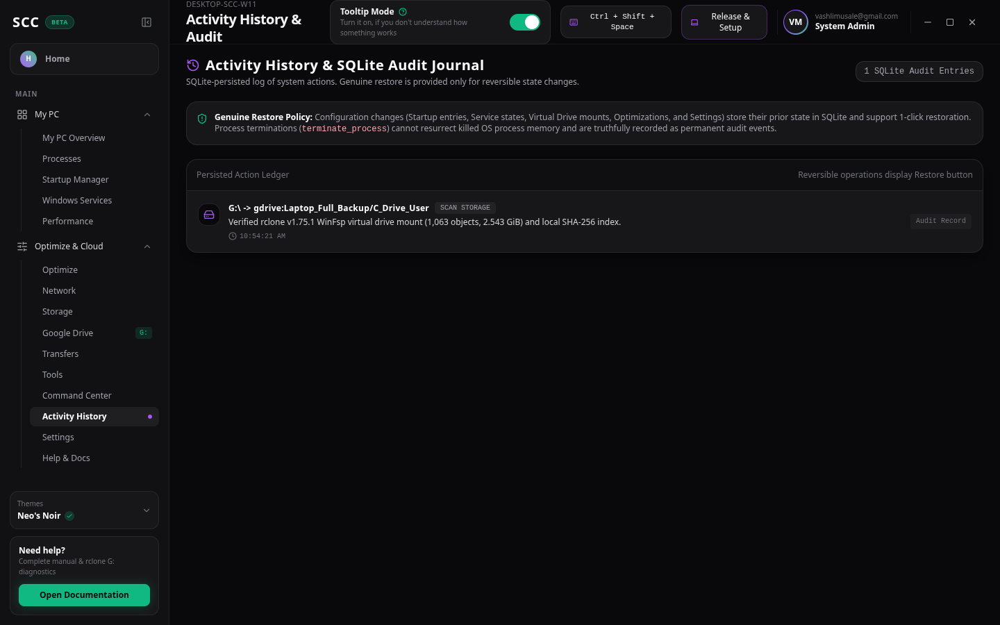

# System Command Center (Unified v2.5.0)

**Unified Windows 11 System Intelligence, Google Drive Virtual Disk (`G:`) & Controlled Local Command Execution Desktop Application**



---

## 1. Key Capabilities

### Module 1: Windows 11 System Intelligence
- **Neo's Noir Bento Dashboard**: Real-time CPU (`49°C`) and GPU (`38°C`) circular SVG temperature gauges, DDR5 RAM & NVMe utilization bars, purple network area sparkline, and persistent Platform Settings switches.
- **Process & Application Intelligence**: Live foreground/background classification, parent-child PID mapping, Authenticode digital signature status, plain-English technical purpose explanations, and 3-tier risk classification (`Protected System Process`, `Review Required`, `Safe Optional`).
- **Safety & Truthful Reversibility**: Protected Windows kernel processes (`ntoskrnl.exe`, `csrss.exe`, `lsass.exe`, `dwm.exe`) are locked against termination. Process termination (`terminate_process`) is strictly recorded as **Non-Reversible**, while Startup Manager, Windows Services, and System Optimization toggles support 1-click **Undo / Restore**.

### Module 2: Storage Intelligence & Google Drive Virtual Mount (`G:`)
- **rclone v1.75.1 + WinFsp 2024.1 Integration**: Mounts `gdrive:Laptop_Full_Backup/C_Drive_User` (`1,063` objects, `2.543 GiB`) directly as Windows drive `G:\` using `--vfs-cache-mode full --network-mode`.
- **Remote Quota Correlation Audit**: Automatically inspects `gdrive:` and `gdrive2:` (`5.000 TiB` total, `22.367 GiB` used, `4.961 TiB` free) and warns that both remotes share the same underlying `5 TiB` Google Drive storage pool (effective capacity `5.000 TiB`, not `10 TiB`).
- **Safe `rclone copy` Enforcement**: Strictly uses `rclone copy` + `rclone check --one-way` (SHA-256 verification) for all backups. Never uses `rclone sync` or `rclone move` automatically.

### Module 3: Controlled Local Windows Command Execution Engine
- **3-Tier Pre-Execution Validation**: Classifies commands into `Safe Read-Only`, `Requires Confirmation` (Admin approval gate), and `Blocked Destructive` (`format`, `diskpart`, `del /s`, `rclone purge`, `rclone sync`).
- **Zero Secret Exposure**: Automatically redacts OAuth tokens, `client_secret`, and `Bearer` headers before displaying output or saving to SQLite (`data/scc_persistence.sqlite`).

---

## 2. Application Screenshots

| Home Dashboard | Google Drive Virtual Mount (`G:`) |
| :---: | :---: |
|  |  |
| **Local Command Center** | **Process Intelligence** |
|  |  |
| **Performance Monitor** | **Activity History & Audit Log** |
|  |  |

---

## 3. Architecture & Workflow Diagrams

- [System Architecture Diagram](docs/diagrams/system-architecture.svg)
- [Google Drive Virtual Mount (`G:`) Workflow](docs/diagrams/google-drive-mount-workflow.svg)
- [Controlled Local Command Execution Workflow](docs/diagrams/local-command-execution-workflow.svg)
- [Application Data Flow & SQLite Persistence](docs/diagrams/application-data-flow.svg)

---

## 4. Quick Start & Windows 11 Installation

### Option 1: Automated Windows 11 Installer (`release/`)
```powershell
Set-ExecutionPolicy -Scope Process -ExecutionPolicy Bypass
.\release\Install-System-Command-Center-Windows.ps1
```
Or double-click `release\Launch-System-Command-Center.bat`.

### Option 2: Local Workstation Server (Node.js v22 + Built-in SQLite)
```bash
npm install
npm test
npm run dev
```
Then open `http://localhost:3000` (or press `Ctrl + Shift + Space` inside the app for the Quick Command HUD).

### Option 3: Native Tauri 2 Windows Desktop Build (`.exe` / `.msi`)
```powershell
npm install -D @tauri-apps/cli@^2.0.0
npx tauri build
```

---

## 5. Complete Documentation Index (`docs/`)

- [`docs/PROJECT_OVERVIEW.md`](docs/PROJECT_OVERVIEW.md) — Executive overview & core safety principles
- [`docs/INSTALLATION_GUIDE.md`](docs/INSTALLATION_GUIDE.md) — Step-by-step Windows 11, rclone, WinFsp, and Tauri 2 setup
- [`docs/USER_MANUAL.md`](docs/USER_MANUAL.md) — Complete walkthrough of all 16 screens & shortcuts
- [`docs/GOOGLE_DRIVE_GUIDE.md`](docs/GOOGLE_DRIVE_GUIDE.md) — Virtual drive `G:` mounting & `gdrive:`/`gdrive2:` quota analysis
- [`docs/COMMAND_EXECUTION_GUIDE.md`](docs/COMMAND_EXECUTION_GUIDE.md) — Command validation tiers, approval gate, and secret redaction
- [`docs/ARCHITECTURE.md`](docs/ARCHITECTURE.md) — React 19 + Tauri 2 + Node/SQLite architecture & schema
- [`docs/TROUBLESHOOTING.md`](docs/TROUBLESHOOTING.md) — Solutions for WinFsp, drive letters, and protected processes
- [`docs/SECURITY.md`](docs/SECURITY.md) — Threat model, non-destructive cloud rules, and token redaction
- [`docs/TEST_REPORT.md`](docs/TEST_REPORT.md) — 15/15 unit test results & Playwright verification report
- [`docs/CHANGELOG.md`](docs/CHANGELOG.md) — Release history for Unified v2.5.0
