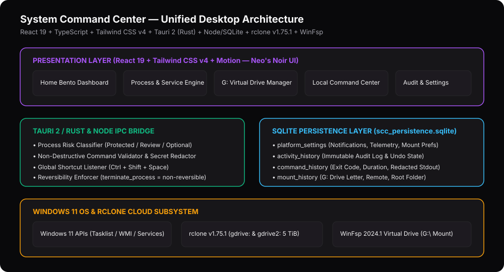
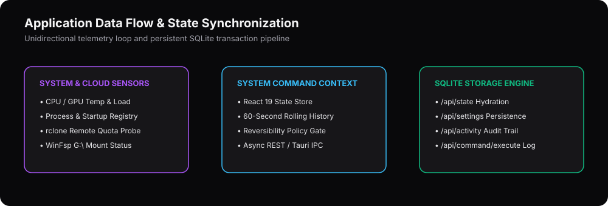

# System Command Center — Technical Architecture





## 1. Unified Multi-Layer Stack

| Layer | Technology | Role |
| :--- | :--- | :--- |
| **Desktop Shell** | Tauri 2 (`src-tauri/src/main.rs`) | Native Windows 11 windowing, Win32 process/rclone bridge, global shortcut registration (`Ctrl+Shift+Space`). |
| **Frontend UI** | React 19 + TypeScript + Tailwind CSS v4 + Motion | Neo's Noir dark theme (`#09090B` / `#171619`), 16 modular views, SVG hardware gauges, interactive telemetry charts. |
| **Pure Domain Logic** | `src/utils/systemIntelligence.ts` & `src/utils/storageIntelligence.ts` | Decoupled, unit-tested business rules: process risk classification, reversibility rules, command validation, secret redaction, WinFsp command builder, and remote quota correlation. |
| **Workstation Server & IPC** | `server.ts` (Express + Node.js v22) | Asynchronous command execution (`/api/command/execute`), live rclone probe (`/api/rclone/status`), and SQLite REST API. |
| **Persistence Engine** | `node:sqlite` (`data/scc_persistence.sqlite`) | Zero-dependency transactional SQLite database persisting `platform_settings`, `activity_history`, `command_history`, and `mount_history`. |

---

## 2. SQLite Schema (`data/scc_persistence.sqlite`)

```sql
CREATE TABLE IF NOT EXISTS platform_settings (
  id INTEGER PRIMARY KEY CHECK (id = 1),
  payload TEXT NOT NULL,
  updated_at TEXT NOT NULL
);

CREATE TABLE IF NOT EXISTS activity_history (
  id TEXT PRIMARY KEY,
  timestamp TEXT NOT NULL,
  category TEXT NOT NULL,
  action_type TEXT NOT NULL,
  target_name TEXT NOT NULL,
  details TEXT NOT NULL,
  reversible INTEGER NOT NULL,
  reverted INTEGER NOT NULL DEFAULT 0,
  payload TEXT NOT NULL
);

CREATE TABLE IF NOT EXISTS command_history (
  id TEXT PRIMARY KEY,
  timestamp TEXT NOT NULL,
  command TEXT NOT NULL,
  working_dir TEXT NOT NULL,
  risk_level TEXT NOT NULL,
  exit_code INTEGER NOT NULL,
  duration_ms INTEGER NOT NULL,
  stdout TEXT NOT NULL,
  stderr TEXT NOT NULL,
  approved_by_user INTEGER NOT NULL
);

CREATE TABLE IF NOT EXISTS mount_history (
  id INTEGER PRIMARY KEY CHECK (id = 1),
  drive_letter TEXT NOT NULL,
  remote_name TEXT NOT NULL,
  remote_folder TEXT NOT NULL,
  mount_status TEXT NOT NULL,
  updated_at TEXT NOT NULL
);
```
