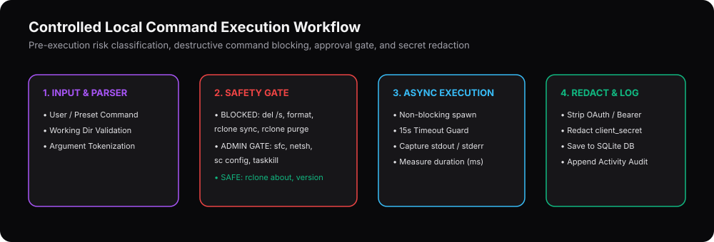

# Controlled Local Windows Command Execution Guide

## 1. Overview

The **Local Command Center** (`CommandCenterView.tsx` + `/api/command/execute`) allows administrators to run verified diagnostic, storage, and system commands directly from the desktop UI with strict pre-execution safety guardrails.

---

## 2. Three-Tier Command Risk Classification

Every command is parsed and evaluated by `validateLocalCommand()` (`src/utils/systemIntelligence.ts`) before execution:

### Tier 1: `Safe Read-Only` (Executes Immediately)
Read-only diagnostic and inspection commands that never alter system state or user files:
- `rclone version`
- `rclone listremotes --long`
- `rclone about gdrive:` / `rclone about gdrive2:`
- `rclone size "gdrive:Laptop_Full_Backup/C_Drive_User"`
- `rclone lsd "gdrive:Laptop_Full_Backup/C_Drive_User"`
- `systeminfo` / `tasklist` / `ipconfig /all` / `whoami`

### Tier 2: `Requires Confirmation` (Explicit Administrator Approval Gate)
Commands that modify system caches, services, processes, or network state require the user to review the plain-English impact explanation and click **Approve & Run**:
- `sfc /verifyonly`
- `ipconfig /flushdns`
- `netsh winsock reset`
- `taskkill /PID <pid>`
- `sc config <service> start= demand`
- `rclone copy <source> <dest>` / `rclone mount ...`

### Tier 3: `Blocked Destructive` (Hard Blocked)
Commands capable of unrecoverable local or cloud data loss are permanently blocked by the validation engine:
- `format`, `diskpart`, `bcdedit`, `cipher /w`
- `del /s`, `rd /s /q C:\`, `rm -rf`, `Remove-Item -Recurse -Force`
- `rclone purge`, `rclone delete`, `rclone sync`, `rclone move` (blocked from automated/unverified execution)

---

## 3. Secret Redaction & SQLite Audit Logging

Before any command output is displayed in the terminal panel or written to `data/scc_persistence.sqlite` (`command_history` table), `redactSecretsFromOutput()` strips:
- `"access_token": "..."` and `"refresh_token": "..."`
- `client_secret = ...`
- `Authorization: Bearer ...`
- Google OAuth `ya29.*` tokens
