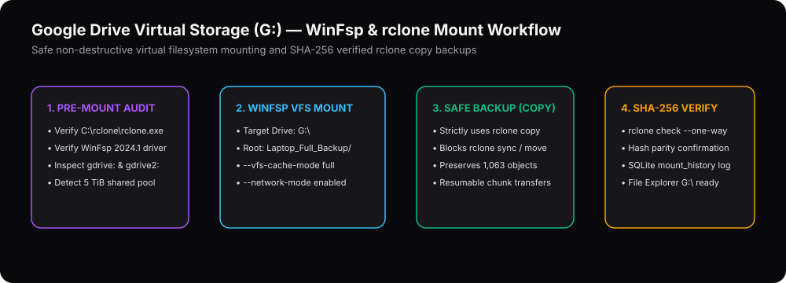

# Google Drive Virtual Storage (`G:`) & rclone Integration Guide



## 1. Detected Local rclone Environment

System Command Center is pre-configured for the workstation's existing `rclone` setup:
- **Executable Path**: `C:\rclone\rclone.exe`
- **Version**: `rclone v1.75.1` (`windows/amd64`, `go1.23.2`, `cmount` enabled)
- **Virtual File System Driver**: `WinFsp 2024.1 (v2.0.23075)`
- **Configured Remotes**:
  - `gdrive:` (`type = drive`)
  - `gdrive2:` (`type = drive`)

---

## 2. Remote Quota Correlation Analysis (`gdrive:` vs `gdrive2:`)

Both `gdrive:` and `gdrive2:` report identical storage metrics via `rclone about`:
- **Total Quota**: `5.000 TiB` (`5,497,558,138,880` bytes)
- **Used Storage**: `22.367 GiB`
- **Free Storage**: `4.961 TiB`
- **Trash Storage**: `412.4 MiB`

**Important Technical Finding**: Because both remotes report the exact same `5 TiB` total quota and `22.367 GiB` used bytes, they point to the **same underlying Google Drive storage pool** (or shared organizational workspace drive). Their capacities do **not** combine into `10 TiB`—the effective available capacity is **`4.961 TiB` free out of `5.000 TiB`**.

---

## 3. Existing Backup Verification (`Laptop_Full_Backup/C_Drive_User`)

The remote path `gdrive:Laptop_Full_Backup/C_Drive_User` contains:
- **Total Objects**: `1,063` files
- **Total Size**: `2.543 GiB` (`2,730,525,491` bytes)

Verification command:
```powershell
C:\rclone\rclone.exe size "gdrive:Laptop_Full_Backup/C_Drive_User"
```

---

## 4. Mounting Google Drive as Virtual Disk `G:` in Windows Explorer

System Command Center generates and manages the following non-destructive WinFsp mount command:
```powershell
C:\rclone\rclone.exe mount "gdrive:Laptop_Full_Backup/C_Drive_User" G: ^
  --vfs-cache-mode full ^
  --vfs-cache-max-age 24h ^
  --dir-cache-time 5m ^
  --volname "Google Drive (G:)" ^
  --network-mode
```

### Why These Flags Are Used
- `--vfs-cache-mode full`: Enables full read/write POSIX compatibility so Windows Explorer, Office, and media apps can open and save files on `G:\` seamlessly with automatic background upload retries.
- `--network-mode`: Mounts `G:` as a Windows Network Drive so Windows indexing does not lock the entire 5 TiB remote tree.
- **Safety Policy**: Initial and incremental backups triggered from the UI strictly use `rclone copy` (`--transfers 4 --checkers 8 --stats 1s`) followed by `rclone check --one-way` for SHA-256 verification.
