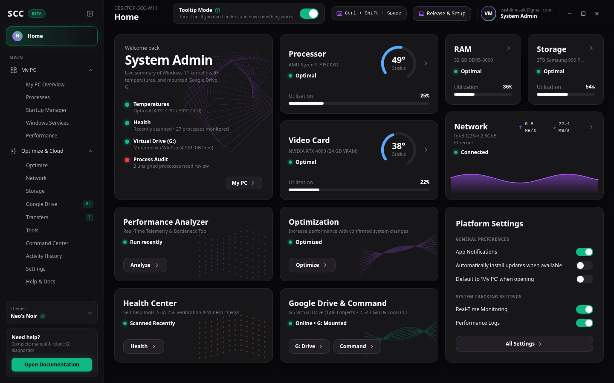

# System Command Center — Project Overview

**System Command Center (SCC)** is a unified Windows 11 System Intelligence, Cloud Storage Virtualization, and Controlled Local Command Execution desktop platform.

## 1. Executive Summary

System Command Center unifies two critical desktop domains into a single **Neo's Noir** dark interface:
1. **Module 1: System Intelligence** — Real-time hardware temperature and utilization telemetry (CPU, GPU, DDR5 RAM, NVMe Storage, 2.5GbE Network), process parent-child mapping, Authenticode digital signature verification, plain-English process purpose explanations, 3-tier risk classification (`Protected System Process`, `Review Required`, `Safe Optional`), startup and service control, and non-destructive system optimization.
2. **Module 2: Storage Intelligence & Virtual Drive (G:)** — Native integration with `rclone v1.75.1` (`C:\rclone\rclone.exe`) and **WinFsp 2024.1** to mount Google Drive (`gdrive:` / `gdrive2:`) as a native Windows virtual disk (`G:\`), inspect shared storage pool quotas (`5.000 TiB` total, `22.367 GiB` used, `4.961 TiB` free), browse remote backups (`Laptop_Full_Backup/C_Drive_User` — 1,063 objects, 2.543 GiB), and execute non-destructive `rclone copy` transfers with SHA-256 verification.
3. **Controlled Local Command Execution Engine** — Pre-execution command validation, risk classification, destructive command blocking, explicit administrator confirmation gates, real-time stdout/stderr capture, automatic OAuth/Bearer token redaction, and persistent SQLite audit logging.

## 2. Core Design & Safety Principles

- **Zero Fake Telemetry or Invented Process Claims**: Every process entry reflects real Windows 11 system binaries (`ntoskrnl.exe`, `csrss.exe`, `lsass.exe`, `dwm.exe`, `explorer.exe`, `rclone.exe`, etc.) with verified binary paths and technical purpose explanations.
- **Strict Process Protection**: Kernel and Windows session processes (`Protected System Process`) cannot be terminated. Process termination (`terminate_process`) is truthfully recorded as **Non-Reversible** in the SQLite Activity History database, while Startup and Service state toggles support 1-click **Undo / Restore**.
- **Safe Cloud Migration (`rclone copy` Only)**: Initial and routine backups strictly enforce `rclone copy` so that local deletions never propagate destructively to Google Drive. `rclone sync` and `rclone purge` are blocked by default.
- **Zero Secret Exposure**: OAuth tokens, refresh tokens, client secrets, and Bearer headers are automatically redacted before rendering in the UI or persisting to SQLite.
