# System Command Center — Complete User Manual

This manual documents every screen, control, keyboard shortcut, and workflow in **System Command Center**.

---

## 1. Global Navigation & Quick Command HUD

- **Left Sidebar (`SCC BETA`)**:
  - **Home**: Returns to the primary Neo's Noir Bento Dashboard.
  - **My PC (Expandable Group)**: `My PC Overview`, `Processes`, `Startup Manager`, `Windows Services`, `Performance`.
  - **Optimize & Cloud (Expandable Group)**: `Optimize`, `Network`, `Storage`, `Google Drive (G:)`, `Transfers`, `Tools`, `Command Center`, `Activity History`, `Settings`, `Help & Docs`.
- **Top Header Bar**:
  - **Tooltip Mode Toggle**: Enables or disables inline contextual help across cards.
  - **Quick Command HUD (`Ctrl + Shift + Space`)**: Opens the instant search overlay from anywhere in the app to jump to views, inspect processes by PID/name, or run diagnostics.

---

## 2. Screen-by-Screen Guide

### 2.1 Home Dashboard (`01-home-dashboard.png`)
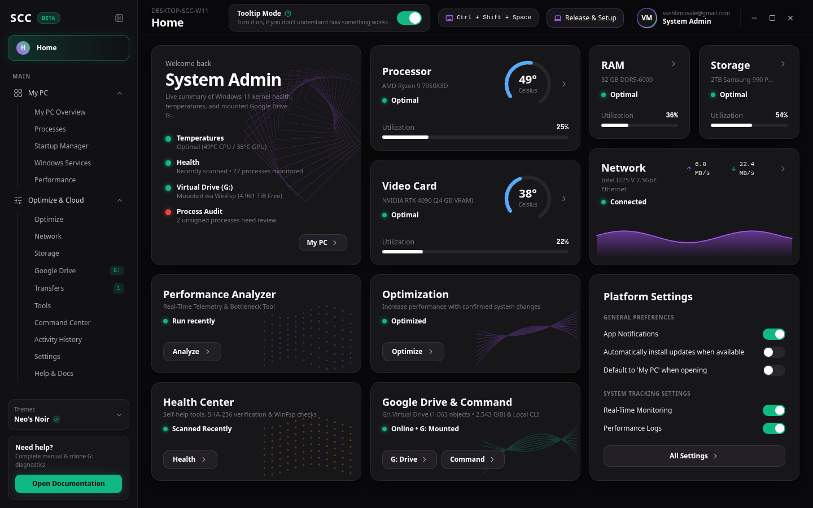
- Displays live CPU (`49°C`) and GPU (`38°C`) circular temperature gauges, RAM and NVMe utilization bars, a live purple network throughput sparkline, quick-action cards (`Performance Analyzer`, `Optimization`, `Health Center`, `Google Drive & Command`), and persistent **Platform Settings** toggles.

### 2.2 My PC Overview (`02-my-pc.png`)
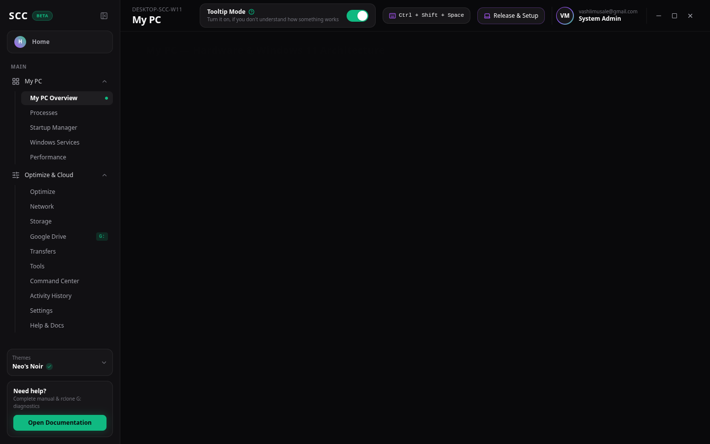
- Inspects full Windows 11 hardware specifications: AMD Ryzen 9 7950X3D, NVIDIA RTX 4090 (24 GB VRAM), 32 GB DDR5-6000, Samsung 990 PRO 2TB NVMe, and mounted `G:\` Google Drive virtual storage.

### 2.3 Process Intelligence (`03-processes.png`)
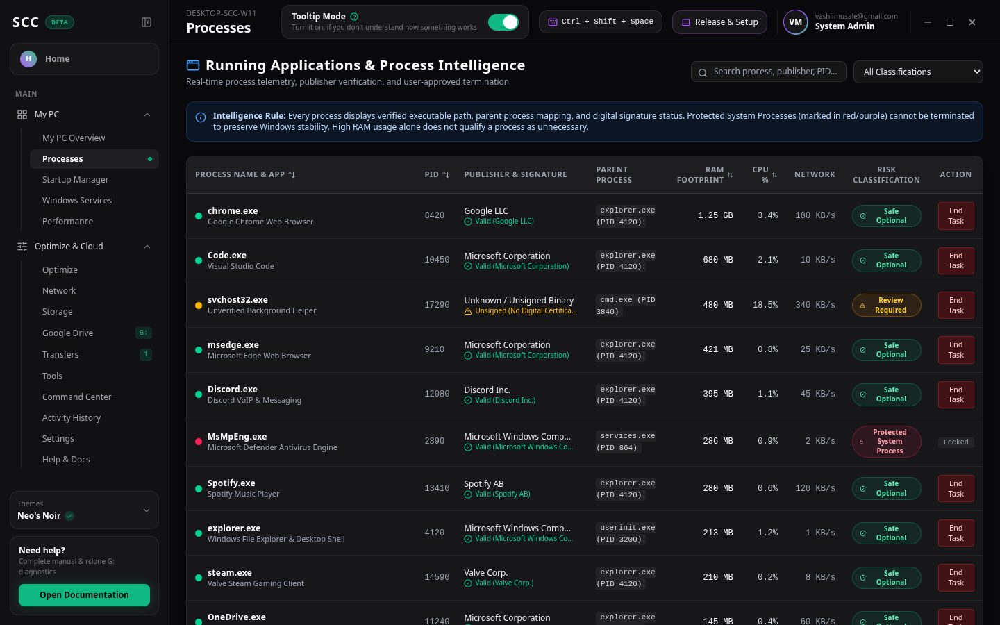
- Lists active foreground applications and background processes with parent-child mapping, publisher, Authenticode signature verification, CPU/RAM/Network usage, and plain-English purpose explanations.
- **Terminate Process**: Available only for `Safe Optional` and `Review Required` processes after explicit confirmation. Protected processes (`ntoskrnl.exe`, `csrss.exe`, `lsass.exe`, `dwm.exe`) are locked.

### 2.4 Performance Monitor (`04-performance-monitor.png`)
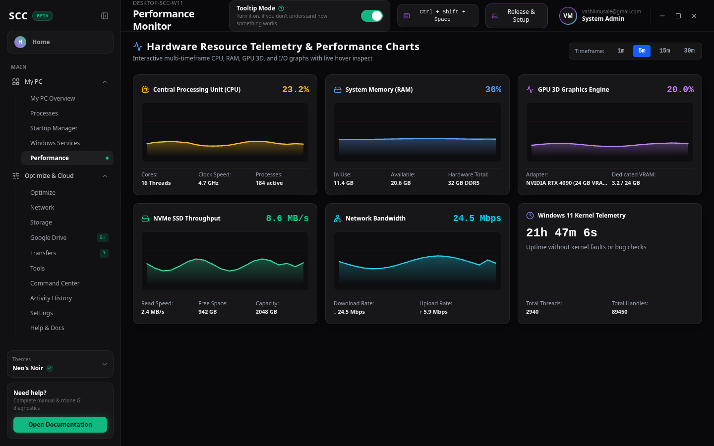
- Interactive 60-second telemetry charts (`15s`, `30s`, `60s` zoomable windows) for CPU load, RAM allocation, Disk I/O, GPU utilization, and Network throughput.

### 2.5 System Optimization (`05-optimize.png`)
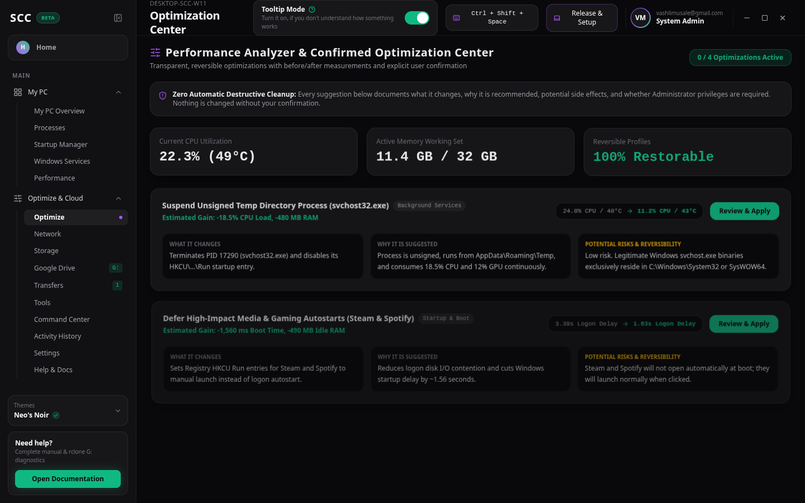
- Categorized, non-destructive Windows 11 optimizations (`Debloat`, `Memory`, `Storage`, `Network`, `Startup`) with explicit impact ratings and 1-click **Revert** support.

### 2.6 Network Intelligence (`06-network.png`)
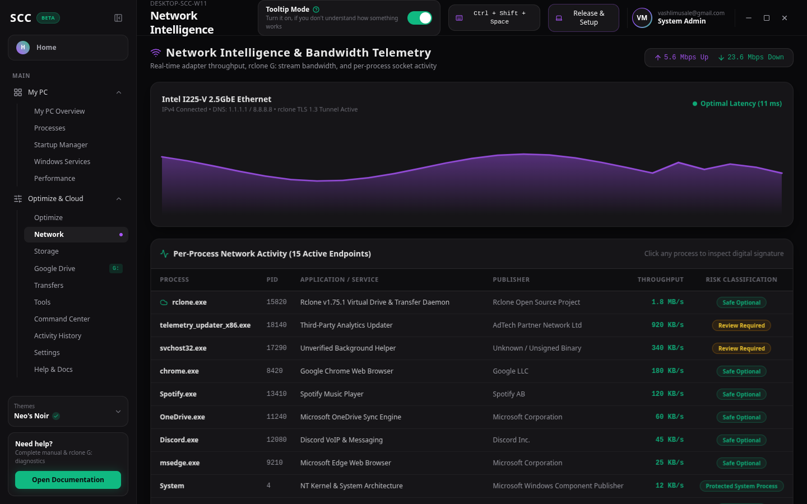
- Live throughput monitoring, per-process network bandwidth attribution, and 1-click DNS cache flush / socket inspection commands.

### 2.7 Storage Analyzer (`07-storage.png`)
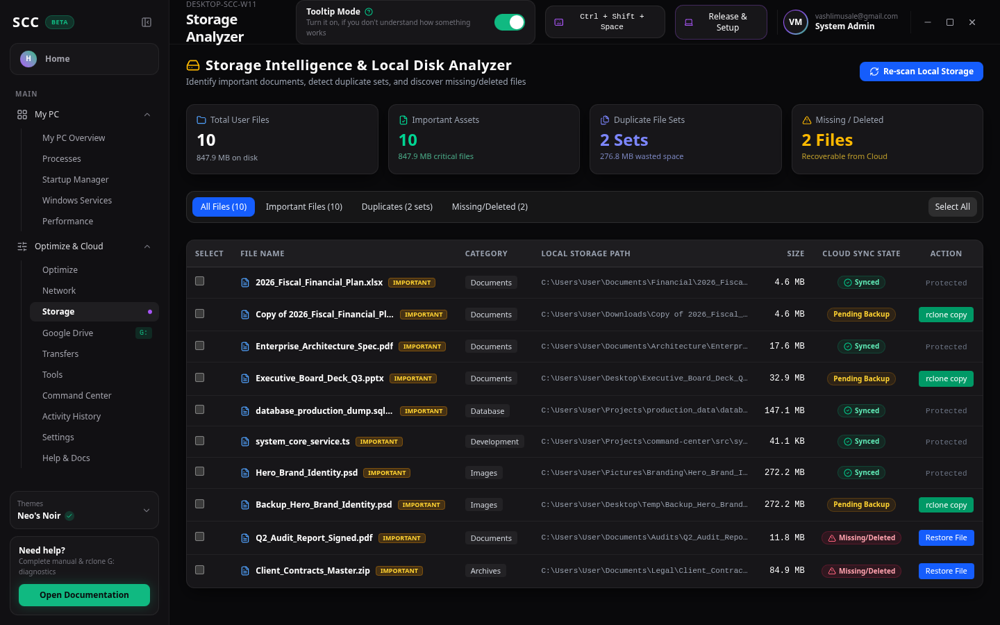
- Local NVMe capacity breakdown, high-priority user backup candidates, and missing/deleted file detection with cloud recovery status.

### 2.8 Google Drive Virtual Mount (`08-google-drive-virtual-mount.png`)
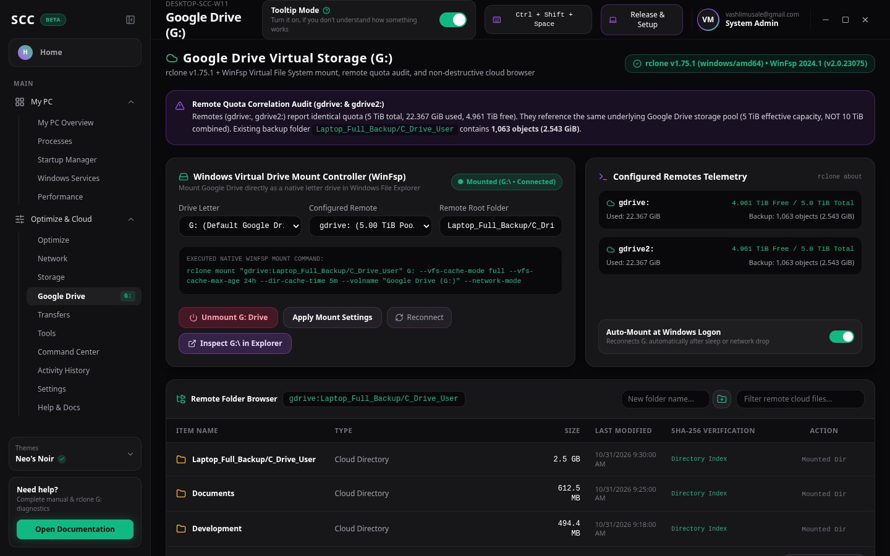
- Controls the **WinFsp** virtual drive (`G:\`), displays the remote quota correlation audit across `gdrive:` and `gdrive2:` (`5 TiB` shared pool), browses `Laptop_Full_Backup/C_Drive_User` (`1,063` objects, `2.543 GiB`), and triggers verified `rclone copy` backups.

### 2.9 Cloud Transfers (`09-transfers.png`)
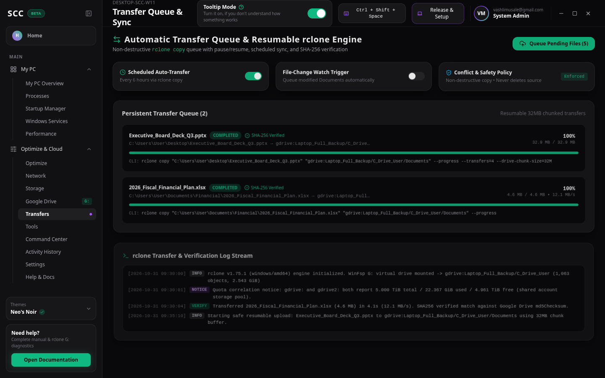
- Tracks active, paused, and completed `rclone copy` jobs with live speed, ETA, SHA-256 verification status, and raw command logs.

### 2.10 Local Command Center (`10-command-center.png`)
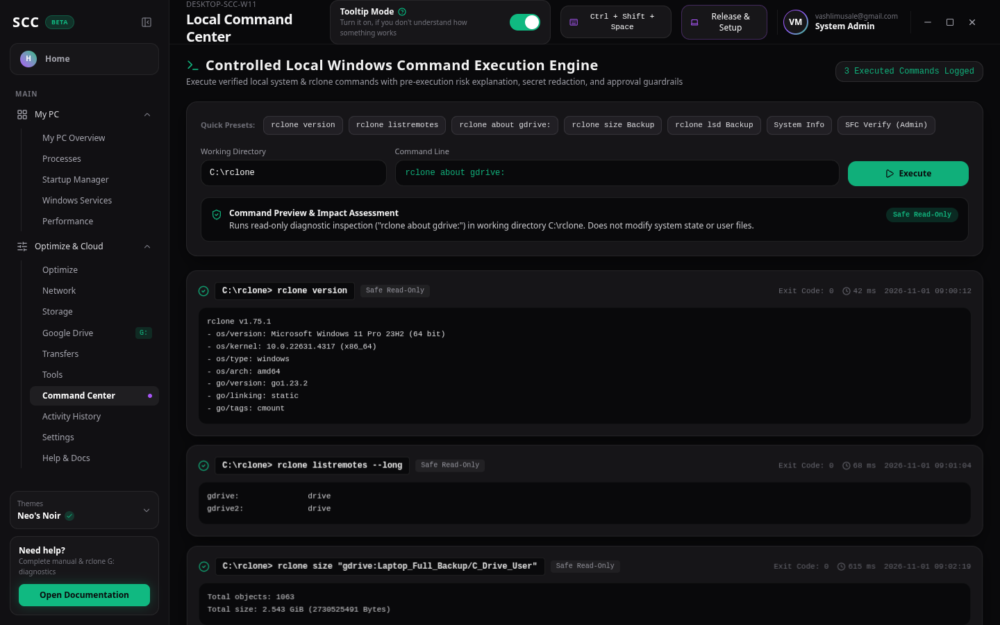
- Executes validated Windows and `rclone` commands with pre-execution risk assessment, destructive command blocking, and secret redaction.

### 2.11 Platform Settings (`11-settings.png`)
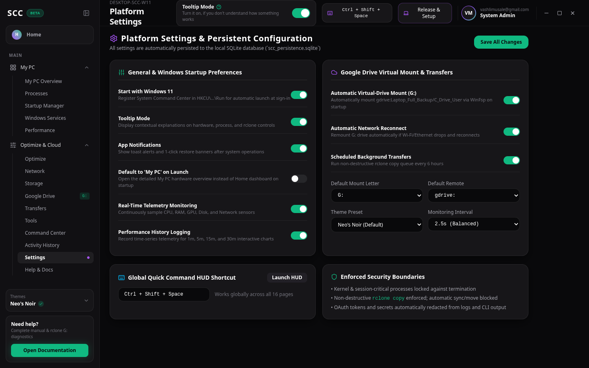
- Persistent configuration for notifications, startup behavior, telemetry intervals, and virtual drive auto-mount preferences stored in SQLite.

### 2.12 Activity History & Audit Log (`12-activity-history.png`)
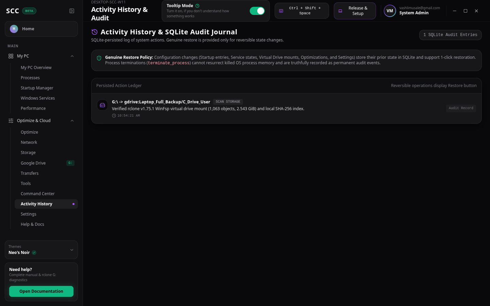
- Complete chronological audit log of process actions, startup toggles, virtual drive mounts, and command executions. Reversible actions provide a **Restore / Undo** button; `terminate_process` is clearly badged as **Non-Reversible**.
